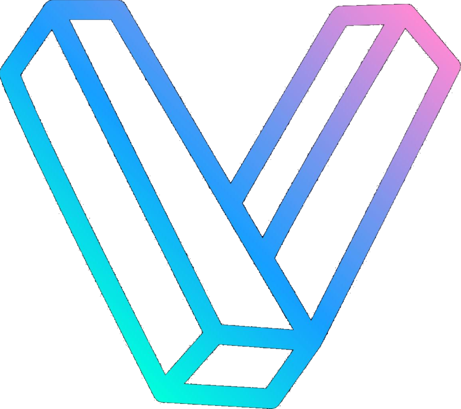

# Vlad Code

> The AI writes. You remain the engineer.

<p align="center">
  
</p>

<p align="center">
  <a href="https://github.com/Nicolas25vlad/vlad-code/actions/workflows/ci.yml"></a>
  <a href="LICENSE"></a>
</p>

## What is Vlad Code?

Vlad Code is an engineering-focused coding agent built on the [Oh My Pi](https://github.com/can1357/oh-my-pi) runtime. It keeps the inherited TypeScript/Bun workspace, Rust native components, terminal UI, provider support, and extension surfaces while adding a Vlad-owned product direction.

**Vlad Code is more than a renamed Oh My Pi.** The fork is the foundation; Vlad-specific systems are being added separately and are labeled by their real implementation status below.

The current executable and published package still belong to the upstream project: `omp` and `@oh-my-pi/pi-coding-agent`. There is no Vlad-branded binary, npm package, or installer yet.

## Why Vlad Code?

- **Keep the engineer in control.** Review changes, approve consequential actions, and choose the models and tools.
- **Work in the real repository.** The agent uses code intelligence, version control, shells, tests, and the project's existing instructions.
- **Build repeatable engineering habits.** The fork is developing explicit specifications, memory, learning, prompts, and delivery workflows without claiming unfinished pieces as shipped.
- **Preserve what already works.** Existing Oh My Pi APIs and protocols remain intact while the product identity changes.

## Features

**Available** means implemented in this repository. **Experimental** means present but still being evaluated. **Planned** means not available yet.

| Status | Capability |
| --- | --- |
| Available | Interactive terminal coding agent, one-shot prompts, RPC, and Agent Client Protocol (ACP) |
| Available | Multiple model providers and per-role model routing |
| Available | Built-in tools, MCP servers, extensions, language servers, and project instructions |
| Available | Parallel subagents, task coordination, and the Agent Hub |
| Available | Code editing, search, shell, browser and desktop tools, debugging, and code review |
| Available | Tern Surface Protocol rendering through the shared UI tree |
| Available | Specification scaffolding with `omp spec new <slug>` |
| Available | Configurable local memory backends and an optional remote Hindsight backend |
| Experimental | Automatic learning and managed-skill updates, inherited from the runtime |
| Planned | Vlad Prompts integration, Vlad Ship release workflow, full specification governance, and continuous background agents |

These capabilities come from the inherited runtime unless a row names a Vlad-specific addition. See [architecture](docs/architecture/README.md), [integration assessment](docs/integrations/README.md), and [roadmap](docs/roadmap/README.md).

## Architecture

Vlad Code is a source fork, not a new runtime. Its current architecture consists of:

- a TypeScript/Bun coding-agent CLI and SDK;
- shared agent, model/provider, catalog, UI, and utility packages;
- Rust crates for native search, shell, editing, and platform integration;
- existing extension, MCP, ACP, RPC, and Tern integration points.

The fork adds project-specific behavior in the coding-agent package and tracks upstream integration as reviewed work. It does not rename imported package scopes, the CLI, runtime paths, or wire protocols; those names are compatibility contracts.

## Installation

There is **no Vlad Code release or Vlad-branded installer yet**. To try this fork, build and run it from source:

```sh
git clone https://github.com/Nicolas25vlad/vlad-code.git
cd vlad-code
bun setup
bun run dev
```

Requires Bun 1.4.4 or newer and the repository's Rust/native build prerequisites. `bun setup` installs workspace dependencies, builds the native addon, and links the current source CLI into Bun's global bin as `omp`.

Do not use the upstream `omp.sh`, Homebrew, Nix, or npm installation commands to install Vlad Code: those install upstream releases, not this fork.

## Quick Start

After the source setup above, `bun run dev` opens the interactive agent. Configure a model provider through the CLI's setup flow or configuration before prompting.

To create a version-controlled specification draft in the current project:

```sh
bun run dev -- spec new <slug>
```

For example:

```sh
bun run dev -- spec new managed-memory --title "Managed memory integration"
```

This creates a draft under `.vlad/specs/`. It scaffolds a specification; it does not run a complete governance, implementation, or verification pipeline.

## Vlad Learning

**Experimental — runtime learning tools are available; no Vlad-specific Hermes integration is shipped.**

The inherited runtime includes `learn` and managed-skill tools, with automatic learning controlled by configuration. They can capture reusable lessons and update managed skills when enabled. Learning behavior is still being evaluated; it is not a promise of unattended or universally correct skill changes.

## Persistent Memory

**Available — select and configure a backend; remote services are not installed or operated for you.**

The runtime supports `memory.backend` values `off`, `local`, `mnemopi`, `sharpshooter`, and `hindsight`. Local options use the rollout-summary pipeline, Mnemopi's SQLite store, or Sharpshooter's project decision files. Hindsight is a remote backend and requires a separately configured Hindsight service and API URL. Memory is off by default.

These are inherited runtime capabilities, not an automatically managed Vlad memory service.

## Vlad Prompts

**Planned — no Vlad Prompts package or installer is wired into this fork.**

The project will evaluate the separate [Vlad Prompts](https://github.com/Nicolas25vlad/vlad-prompts) repository as a provider-neutral prompt source. Existing runtime prompts and user skills remain unchanged until an integration is implemented.

## Vlad Ship

**Planned — no Vlad Ship command or release automation is available.**

The current release and distribution pipeline is inherited from Oh My Pi. A Vlad-owned shipping workflow will be documented here only after it exists and has been verified end to end.

## Engineering Governance

**Available:** `omp spec new <slug>` creates a structured draft in `.vlad/specs/`.

**Planned:** complete lifecycle management for specifications, implementation plans, validation evidence, and incremental commits. The current command is scaffolding only; it does not enforce approval gates or automatically verify a change.

## Multi-Agent System

**Available:** the inherited runtime can run parallel subagents, coordinate tasks, and expose worker activity through Agent Hub.

**Planned:** Vlad-specific orchestration policies and continuous engineering agents. The existing worker system does not claim to run backlog, sentinel, or “dreaming” agents in the background.

## Tern Integration

**Available — inherited Tern Surface Protocol support.**

The existing UI tree can render through Tern's native surface integration. Vlad Code preserves that protocol and its runtime identifiers for compatibility. A Vlad-specific Tern plugin, workflow, or expanded surface is not implemented.

## Configuration

Runtime configuration and compatibility paths still use the upstream `omp` names. The CLI can guide initial setup; detailed settings are in the [configuration reference](docs/config-usage.md).

The project specification command writes to `.vlad/specs/`. Do not rename `~/.omp`, `OMP_*` variables, package scopes, or protocol identifiers: they are used by the inherited runtime and integrations.

## Roadmap

See the [roadmap status](docs/roadmap/README.md) for completed foundation work and remaining milestones. Planned items are not shipped features.

## Contributing

Small documentation updates and focused fixes can go directly to a pull request. Discuss major features and architectural changes in the upstream community before implementation, as described in [CONTRIBUTING.md](CONTRIBUTING.md). Contributors must review generated changes and verify the behavior they submit.

## Upstream & Acknowledgments

Vlad Code is an independent fork of [Oh My Pi](https://github.com/can1357/oh-my-pi), which builds on [Pi](https://github.com/badlogic/pi-mono) by [Mario Zechner](https://github.com/mariozechner). The inherited runtime and project history include work by [Can Bölük](https://github.com/can1357), [Stencil Labs](https://stencil.so), and the Oh My Pi contributors.

Vlad Code is not an official Stencil Labs or Oh My Pi release. Upstream notices and third-party licenses are preserved; see [LICENSE](LICENSE) and [THIRD_PARTY_NOTICES.md](THIRD_PARTY_NOTICES.md). No Hindsight, Hermes Agent, or Vlad Prompts source code is bundled by this README change.

## License

The inherited code is distributed under the [MIT License](LICENSE), subject to its existing copyright notices and the licenses of third-party and vendored components.
